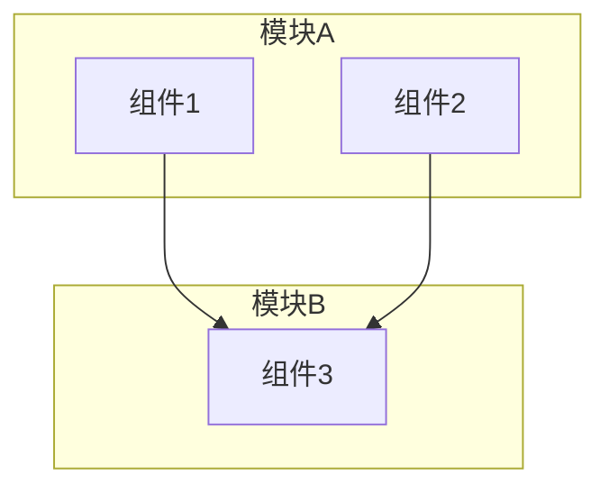
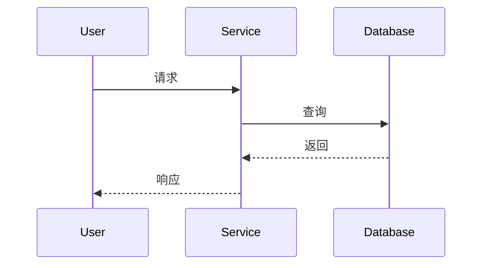

# 技术方案设计

**项目名称**: [项目名称]
**作者**: [作者]
**版本**: v1.0
**日期**: [日期]
**状态**: 草稿 / 评审中 / 已通过

---

## 术语表

> 无特殊术语可删本节。

| 术语 | 解释 |
|------|------|
| [术语] | [解释] |

---

## 一、背景

### 1.1 一句话问题

> 谁在什么约束下做不成什么。一句说完。

### 1.2 现状与影响

> 现在怎么做、卡在哪、影响谁。短句列举，不写故事。

---

## 二、目标

### 2.1 核心目标

| 目标 | 衡量方式 |
|------|----------|
| [目标] | [指标或验收标准] |

### 2.2 非目标

| 明确不做 | 原因 |
|----------|------|
| [事项] | [为何不做或不在本期] |

---

## 三、关键权衡

> 先填本表，再写架构。至少一行。

| 权衡点 | 选项 A | 选项 B | 选择 | 为何 |
|--------|--------|--------|------|------|
| [例如：一致性 vs 吞吐] | [做法] | [做法] | A/B | [一句话] |

---

## 四、方案

### 4.1 方案概述

> 三到五句：选了什么、主路径是什么、刻意放弃什么。

### 4.2 整体架构



### 4.3 主路径

> 优先条件→动作表；交互复杂再用时序图。

| 条件 | 动作 | 结果 |
|------|------|------|
| [触发] | [系统做什么] | [可见结果] |



### 4.4 备选方案（可选）

| 维度 | 方案 A | 方案 B |
|------|--------|--------|
| 描述 |  |  |
| 优点 |  |  |
| 缺点 |  |  |
| 复杂度 | 低/中/高 | 低/中/高 |

**推荐**: [方案 X] — [一句理由]

---

## 五、核心模块

### 5.1 [模块名]

| 项 | 内容 |
|----|------|
| 职责 | [一句话] |
| 输入 | [事件 / 请求 / 数据] |
| 输出 | [对外结果] |
| 明确不做 | [边界] |

**关键逻辑**

| 条件 | 动作 |
|------|------|
| [条件] | [动作] |

**接口（按需）**

```typescript
interface Example {
  id: string;
  name: string;
}
```

### 5.2 [模块名]

> 按需追加。每个模块都填职责 / 输入 / 输出 / 不做。

---

## 六、风险与应对

| 风险 | 影响 | 概率 | 应对 |
|------|------|------|------|
| [描述] | 高/中/低 | 高/中/低 | [动作] |

---

## 七、排期（可选）

| 阶段 | 内容 | 交付物 |
|------|------|--------|
| Phase 1 |  |  |
| Phase 2 |  |  |

---

## 八、附录

### 参考资料

- [链接或文档]

### 变更记录

| 版本 | 日期 | 作者 | 变更 |
|------|------|------|------|
| v1.0 | [日期] | [作者] | 初稿 |
