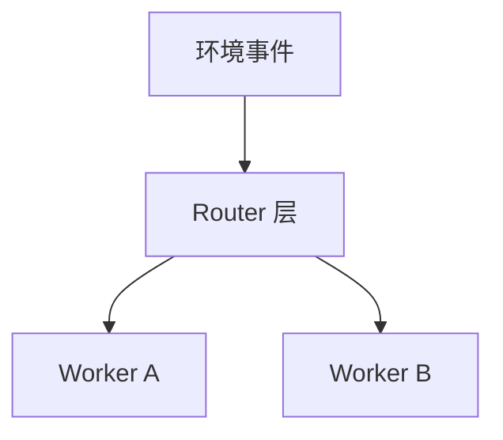
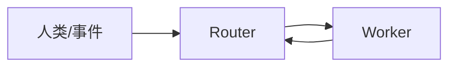

# 架构探索：[主题]

**作者**: [作者]
**日期**: [日期]
**状态**: 探索中 / 已内部验证
**性质**: 架构思路探讨与路线验证，不是产品功能说明

---

## 0. 一句话瓶颈

> 今天限制进一步提升的，是 [能力 / 注意力 / 吞吐 / …]，不是 [常见误判]。

---

## 1. 形态定义

> 3–5 条可检验特征。写成「系统必须表现出…」，便于对照实现。

| # | 特征 | 可观察表现 |
|---|------|------------|
| 1 | [例如：连续] | [跨信道仍像同一个实体] |
| 2 | [例如：高效] | [可并行推进且互不阻塞交互] |
| 3 | [例如：主动] | [事件驱动；无事保持安静] |
| 4 | [例如：持久] | [异常可自愈 / 跨设备仍在线] |

---

## 2. 总图与模块地图

> 模块编号必须与下文章节一致。

| 编号 | 模块 | 本节要解决的权衡 |
|------|------|------------------|
| §3 | [双层架构] | [连续 vs 吞吐] |
| §4 | [事件驱动] | [主动 vs 噪音成本] |
| §5 | […] | […] |

---

## 3. [第一节标题：一个权衡]

**断言：** [本节唯一结论，加粗短句]

### 3.1 若只走极端会怎样

| 极端 | 得到 | 失去 |
|------|------|------|
| [全连续单会话] | [上下文最完整] | [吞吐低 / 任务互相污染] |
| [每事件新会话] | [吞吐最高] | [割裂 / 交互混乱] |

### 3.2 机制

> 借用的经典思想（可选一句）：[Fast/Slow Path / 存算分离 / …]

| 角色 | 输入 | 输出 | 明确不做 |
|------|------|------|----------|
| [Router] | [人类交互 / 未订阅事件] | [分派 / 对外回复] | [不执行具体重任务] |
| [Worker] | [已订阅 Thread] | [向 Router 汇报] | [不直接对用户多嘴] |

### 3.3 落地变体（可选）

> 实现上允许的简化或扩展，各用一句。

---

## 4. [第二节标题：下一个权衡]

**断言：** […]

> 重复「极端对照 → 机制表 → 图」结构。一节不塞两个权衡。

---

## 5. 验证

> 只证明架构主张。合成负载、调度指标、token 开销均可；不要写成模型能力评测。

| 主张 | 怎么证伪 | 当前结果 |
|------|----------|----------|
| [双层优于单会话+提示词委派] | [完成时间 p50/p95] | [数据或「待测」] |
| [直通降低 Router 负载] | [Router 决定次数 / 读缓存 token] | [数据或「待测」] |

---

## 6. 开放问题

| 问题 | 为何现在不关闭 | 可能方向 |
|------|----------------|----------|
| [Router 何时要切分] | [规模未到] | [分层过滤 / Sharding] |
| [长程记忆] | [近期召回够用] | […] |
| [安全与凭据] | [可信边界假设] | […] |

---

## 7. 原型指针

> 正文到此结束论证。实现仓库或插件用一句话挂上，避免写成产品手册。

- 原型 / 仓库：[链接]
- 已验证范围：[一句话]
- 非目标：[不是正式产品 / 未覆盖…]

---

## 变更记录

| 版本 | 日期 | 变更 |
|------|------|------|
| v0.1 | [日期] | 初稿 |
