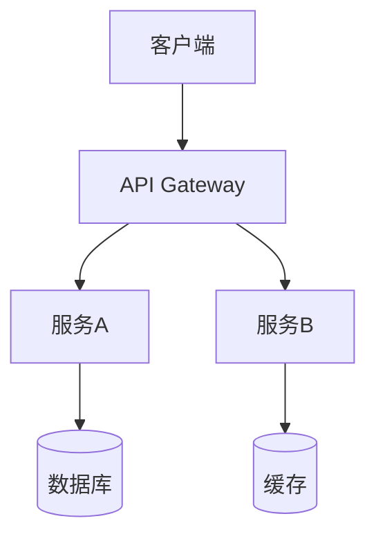
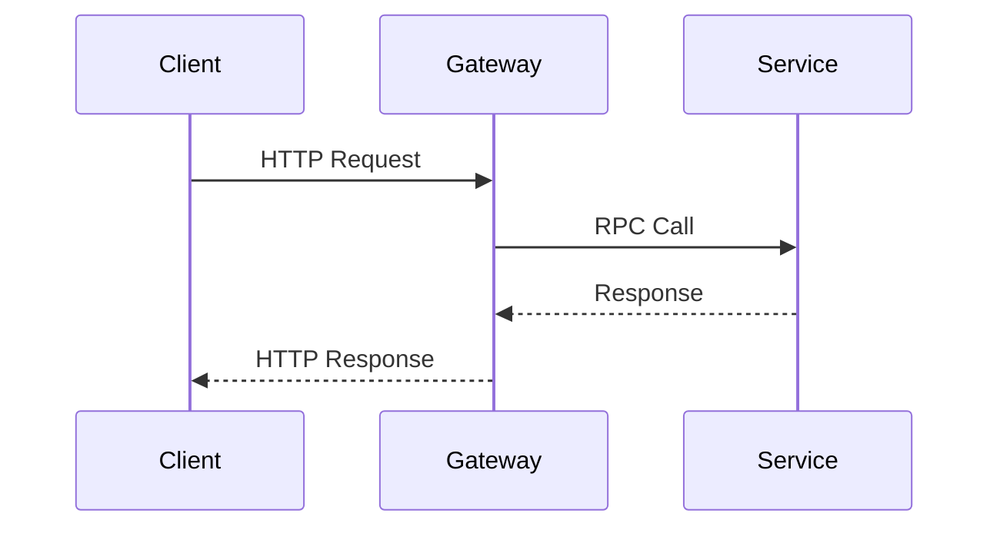
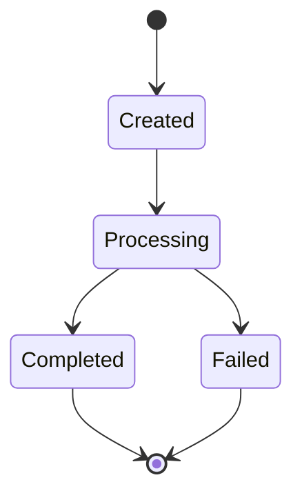

# 技术方案设计参考

按需查阅。主流程与硬规则以 `SKILL.md` 为准。

## 常见架构模式（选型起点）

| 模式 | 适用 | 主要代价 |
|------|------|----------|
| 分层 | 传统 Web / CRUD | 层间耦合、变更面大 |
| 微服务 | 大型、需独立部署 | 运维与分布式复杂度 |
| 事件驱动 | 高并发、异步、松耦合 | 调试与一致性 |
| 六边形 / DDD | 复杂领域、要可测 | 学习成本与代码量 |
| 双层 Router/Worker | 多任务连续交互 + 并发执行 | 会话与路由工程、token 开销 |

选型必须落成 Trade-off 表，不要只抄推荐列。

## Mermaid 速查

### 架构

### 时序

### 状态

注意：方括号内避免双引号与嵌套括号；节点 id 用英文，中文放在标签里。

## 评审方案 vs 架构探索（速查）

| | 评审方案 | 架构探索 |
|--|----------|----------|
| 目的 | 拍板落地 | 证明路线 |
| 读者 | 评审人 / 实现者 | 同行工程师 |
| 骨架 | 背景→目标→权衡→方案→模块→风险 | 瓶颈→特征→总图→分节权衡→验证→开放问题 |
| 原型 | 可附实现计划 | 文末指针即可 |
